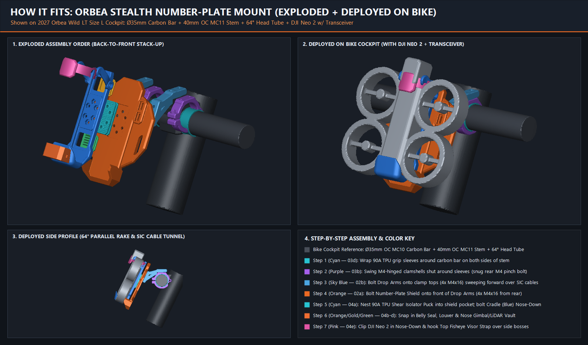
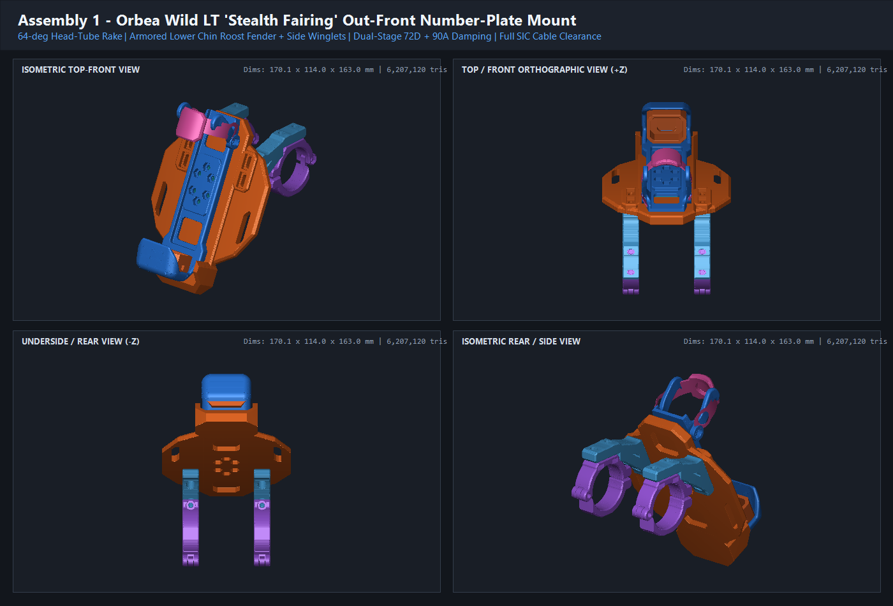
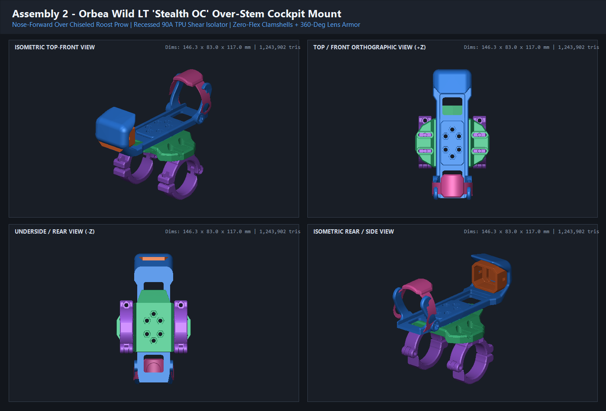
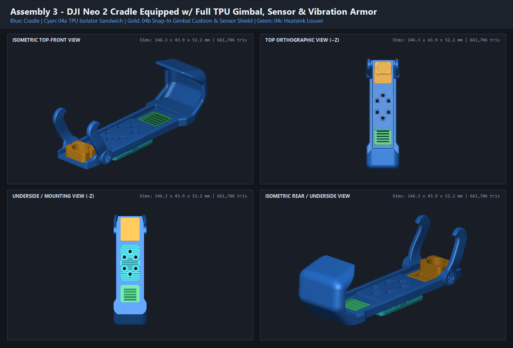
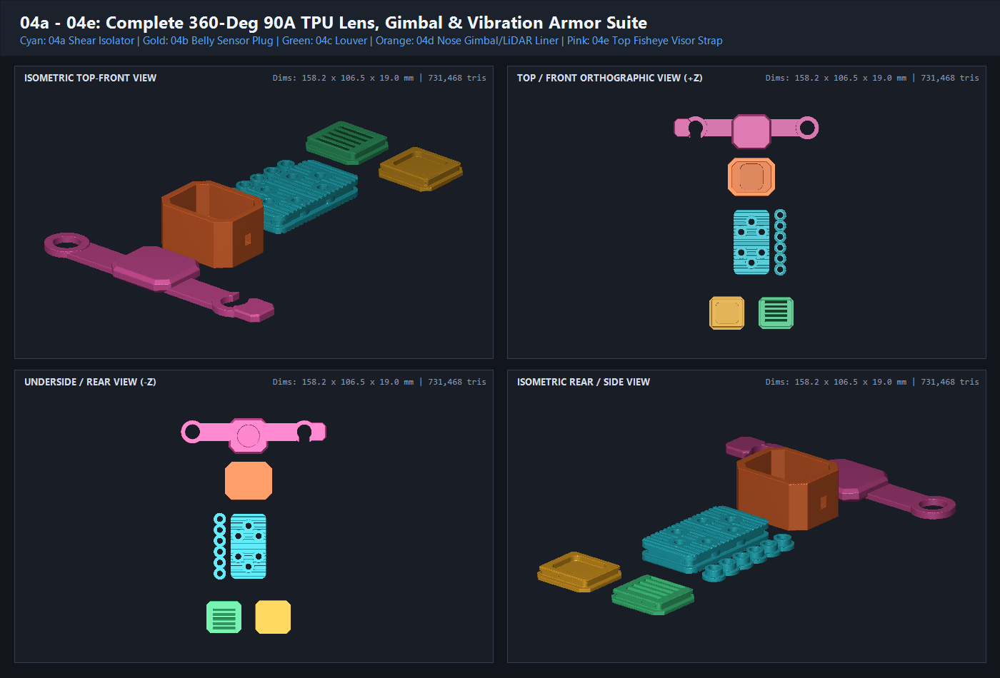
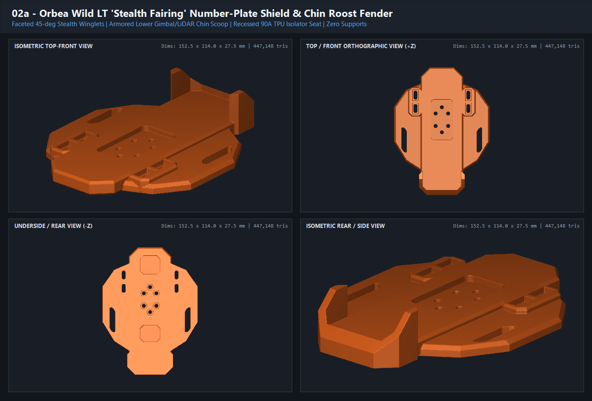
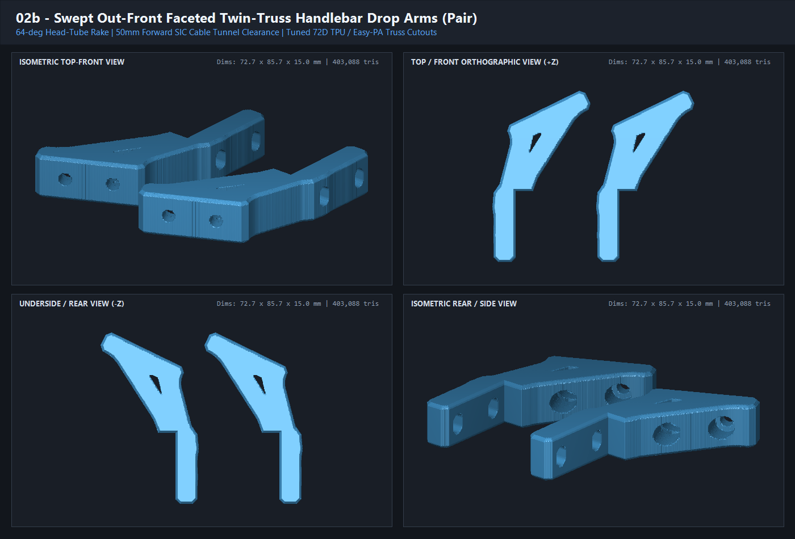
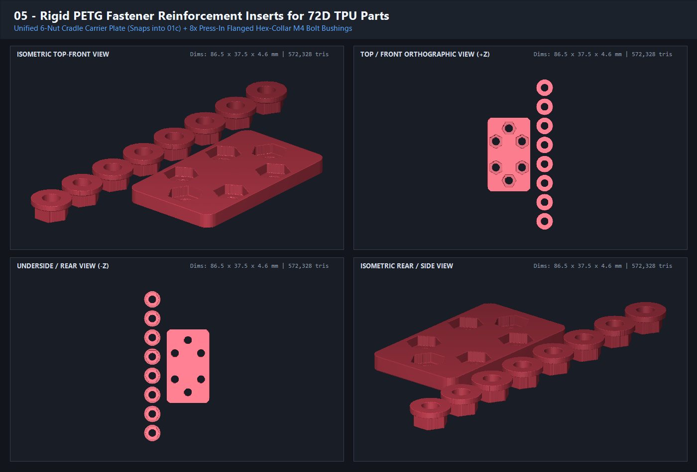
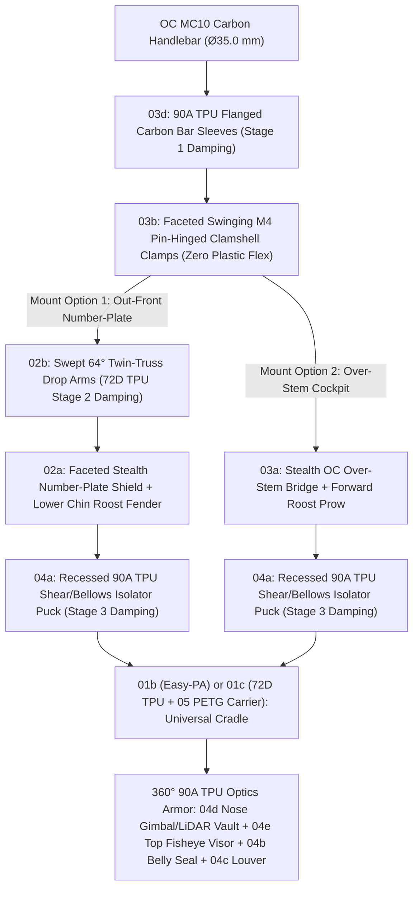

# DJI Neo 2 (w/ Transceiver) × 2027 Orbea Wild LT M-Team
### Orbea Stealth Cockpit Mount Suite: Out-Front Number-Plate Fairing, Over-Stem OC Bridge & 360° TPU Lens Armor

-ff6600?style=for-the-badge)
-00ae42?style=for-the-badge)

 

  <b>Two dedicated 100% knee-free cockpit mounting systems</b> sculpted in the angular stealth design language of the <b>2027 Orbea Wild LT M-Team (Size Large)</b>: 
  <b>(1) Out-Front "Stealth Fairing" Number-Plate Mount</b> (<code>64°</code> Head-Tube Rake + Armored Chin Roost Fender) &nbsp;|&nbsp;
  <b>(2) "Stealth OC" Over-Stem Bridge Mount</b> (Forward Roost Prow + Recessed Shear Isolator) &nbsp;|&nbsp;
  <b>(3) 360° 90A TPU Lens, LiDAR & Gimbal Armor</b>

[Quick Download (.3MF Plates)](#-one-click-bambu-studio-build-plates-3mf) •
[360° Lens & Vibration Engineering](#-360-lens-protection--multi-durometer-vibration-damping) •
[Visual Gallery](#-3d-assembly--component-gallery) •
[STL Catalog](#-individual-stl-part-catalog) •
[Graded-Durometer Print Matrix](#-bambu-lab-p2s-04mm-hf-tc-graded-durometer-slicer-matrix) •
[Hardware BOM & Assembly](#-hardware-bill-of-materials--assembly-guide)

---

## ⚡ One-Click Bambu Studio Build Plates (`.3mf`)

All parts are pre-oriented on `256 × 256 mm` build plates for the **Bambu Lab P2S** for **zero-support printing** (except the small underside arch ceiling of `03a`) and optimal continuous-perimeter fiber strength:

| Build Plate | Recommended Filament | Contents | Download |
| :--- | :--- | :--- | :---: |
| **Plate 1 — Stealth Number-Plate Mount** | `Elegoo 72D TPU` or `Sunlu Easy-PA` | Faceted Number-Plate Shield w/ Chin Roost Fender (`02a`) + Swept Twin-Truss Handlebar Drop Arms (`02b`) — **Zero Supports!** | [**Download Plate 1 (.3mf)**](3mf/Plate1_NumberPlate_Stealth_Mount_72D_Or_EasyPA.3mf) |
| **Plate 2 — Stealth OC Over-Stem Mount** | `Sunlu Easy-PA` or `ASA` | Chiseled Over-Stem Bridge w/ Front Roost Prow (`03a`) + Faceted Swinging M4 Pin-Hinged 35mm Handlebar Clamps (`03b`) | [**Download Plate 2 (.3mf)**](3mf/Plate2_OverStem_Stealth_Bridge_And_Clamps.3mf) |
| **Plate 3 — 360° 90A TPU Lens & Vibration Armor** | `90A TPU` *(or `95A TPU`)* | Carbon Bar Sleeves (`03d`) + Shear Isolator Puck & Grommets (`04a`) + Belly Sensor Seal (`04b`) + Heatsink Louver (`04c`) + Nose Gimbal/LiDAR Vault (`04d`) + Top Fisheye Visor Strap (`04e`) | [**Download Plate 3 (.3mf)**](3mf/Plate3_90A_TPU_Lens_Gimbal_And_Vibration_Armor.3mf) |
| **Plate 4 — Easy-PA (45°) & 72D TPU (Flat) Cradles** | `Sunlu Easy-PA` / `Elegoo 72D TPU` | 45° Pre-Angled Cradle w/ Snap-Off A-Frame Anchor Fin (`01b`) + Flat Pocketed 72D TPU Cradle (`01c`) | [**Download Plate 4 (.3mf)**](3mf/Plate4_Cradles_45Deg_EasyPA_And_Flat_72D.3mf) |
| **Plate 4c — Flat 72D TPU Flex-Clip Cradle** | `Elegoo 72D TPU` | Flat `Z=0` Flex-Clip Cradle (`01e`): `29°` self-supporting nose chin, smooth `2.8 mm` flex arms, & flush `14 × 3.5 mm` FPV LiPo Velcro strap loops | [**Download Plate 4c (.3mf)**](3mf/Plate4c_Cradle_Flat_EasyPA_FlexClip.3mf) |
| **Plate 4d — Flat Easy-PA Reinforced Cradle** | `Sunlu Easy-PA` | Flat `Z=0` Reinforced Cradle (`01f`): `29°` self-supporting nose chin, tapered `4.5 → 3.2 mm` lump-free arms (`+125%` bend strength), & flush `14 × 3.5 mm` FPV strap loops | [**Download Plate 4d (.3mf)**](3mf/Plate4d_Cradle_Flat_EasyPA_Reinforced.3mf) |
| **Plate 5 — Rigid PETG Fastener Inserts** | `PETG` / `ASA` | Unified 6-Nut Cradle Carrier Plate (snaps into `01c`) + 8× Flanged Hex-Collar M4 Bolt Bushings | [**Download Plate 5 (.3mf)**](3mf/Plate5_PETG_Inserts_For_72D_TPU.3mf) |

---

## 🛡️ 360° Lens Protection & Multi-Durometer Vibration Damping

<table>
  <tr>
    <td width="42%" align="center">
      
       
      <b>Reference Holster Fitment:</b> Notice the exposed top-rear omnidirectional fisheye lens right ahead of the Digital Transceiver—now completely covered by our <code>04e</code> Faceted TPU Visor Strap!
    </td>
    <td width="58%">
      <h3>Every Optical Element Shielded from Trail Roost</h3>
      <ul>
        <li><b>Main 2-Axis Gimbal Camera + Forward LiDAR (Nose):</b> Protected inside a <b>double-walled vault</b>. The soft <b><code>04d</code> 90A TPU Nose Liner</b> closes off the left/right side gaps of the cradle's nose cup, gently immobilizes the outer gimbal barrel to prevent end-stop hammering, and leaves a deep non-contact optical dome over the glass lens and LiDAR. On the Number-Plate Mount, the nose nests inside an <b>Armored 45°-Faceted Lower Chin Fender</b> that deflects front-tire rock/mud spray.</li>
        <li><b>Top-Rear Omnidirectional Fisheye Lens (Ahead of Transceiver):</b> Shielded by the <b><code>04e</code> Faceted 90A TPU Visor Strap</b>, which hooks onto the cradle's built-in <code>Ø10.5 mm</code> side bosses, suspends a <code>Ø16.4 mm</code> non-contact dome over the fisheye glass, and acts as a fail-safe secondary retention strap.</li>
        <li><b>Downward Vision Fisheye + IR ToF Sensors (Belly):</b> Sealed 100% against mud and water by the snap-in <b><code>04b</code> 90A TPU Belly Sensor Plug</b>.</li>
        <li><b>Fox 38 Bottom-Out & Orbea SIC Cable Clearance:</b> On the Size Large Wild LT (<code>130 mm</code> head tube, <code>63.9°</code> HTA), the Number-Plate drop arms sweep <code>50 mm</code> forward (leaving a wide-open tunnel for Orbea SIC headset cables) and hold the chin fender <code>>60 mm</code> above the bottom of the Fox 38 crown—impossible for the front tire to touch even at full <code>170 mm</code> bottom-out.</li>
      </ul>
    </td>
  </tr>
</table>

---

## 📸 3D Assembly & Component Gallery

### Complete Cockpit Assemblies & 360° Lens Armor

  
   
  <b>How It Fits Together:</b> Exploded stack-up order, deployed 3/4 view with the DJI Neo 2 + Transceiver clipped in, and side profile showing the <code>64°</code> parallel head-tube rake and open Orbea SIC cable tunnel.

<table>
  <tr>
    <td width="50%" align="center">
      
       
      <b>Assembly 1: Orbea "Stealth Fairing" Out-Front Number-Plate Mount</b> 
      Raked at <code>64°</code> parallel to the Wild LT head tube. Features faceted side winglets, armored lower chin roost scoop, swept <code>72D TPU</code> truss drop arms, and <code>90A TPU</code> isolator + 360° lens armor.
    </td>
    <td width="50%" align="center">
      
       
      <b>Assembly 2: Orbea "Stealth OC" Over-Stem Cockpit Mount</b> 
      Oriented nose-forward over the chiseled front roost-deflector prow, with a <code>3.5 mm</code> recessed <code>90A TPU</code> shear isolator pocket and zero-flex hinged <code>Ø35.0 mm</code> bar clamps.
    </td>
  </tr>
  <tr>
    <td width="50%" align="center">
      
       
      <b>360° Lens-Armored Cradle Assembly</b> 
      <b>Orange:</b> <code>04d</code> Nose Gimbal/LiDAR Vault &nbsp;|&nbsp; <b>Pink:</b> <code>04e</code> Top Fisheye Visor Strap &nbsp;|&nbsp; <b>Gold:</b> <code>04b</code> Belly Sensor Seal &nbsp;|&nbsp; <b>Green:</b> <code>04c</code> Louver &nbsp;|&nbsp; <b>Cyan:</b> <code>04a</code> Shear Isolator.
    </td>
    <td width="50%" align="center">
      
       
      <b>Complete 5-Part <code>90A TPU</code> Lens, Gimbal & Vibration Suite (<code>04a</code>–<code>04e</code>)</b> 
      All 5 parts print flat on the bed with zero supports in a single run on Plate 3.
    </td>
  </tr>
</table>

### Individual Stealth Component Inspection Sheets

<table>
  <tr>
    <td width="50%" align="center">
      
       
      <b><code>02a</code> — Orbea Stealth Number-Plate Shield & Chin Roost Fender</b> 
      Prints 100% flat on its back (<code>Z = 0</code>, zero supports) with chiseled <code>45°</code> stealth facets, aero winglet slashes, and a recessed <code>90A TPU</code> isolator seat.
    </td>
    <td width="50%" align="center">
      
       
      <b><code>02b</code> — Swept Out-Front Faceted Twin-Truss Drop Arms (Pair)</b> 
      Bolts directly to the shared <code>03b</code> handlebar clamps, sweeping <code>50 mm</code> forward around the Orbea SIC cable bundle and angling the shield to <code>64°</code>.
    </td>
  </tr>
  <tr>
    <td width="50%" align="center">
      
       
      <b><code>03a</code> — Stealth OC Over-Stem Bridge w/ Front Roost Prow</b> 
      Octagonal <code>45°</code> chamfered wings, V-creased forward mud-deflector prow, <code>46 mm</code> stem arch, and recessed <code>3.5 mm</code> top isolator pocket.
    </td>
    <td width="50%" align="center">
      
       
      <b><code>03b</code> — Faceted OC-Styled Swinging 35mm Handlebar Clamps</b> 
      Shared base clamps for BOTH mounts! 3-knuckle front M4 bolt hinge swings open <code>180°</code> over the <code>35 mm</code> bar with zero plastic bending.
    </td>
  </tr>
  <tr>
    <td width="50%" align="center">
      
       
      <b><code>01b</code> — 45° Sunlu Easy-PA Cradle w/ Snap-Off A-Frame Anchor Fin</b> 
      Runs continuous Nylon strands through the latch hooks and nose cup with zero slicer supports.
    </td>
    <td width="50%" align="center">
      
       
      <b><code>05</code> — Rigid PETG Fastener Reinforcement Inserts for 72D TPU</b> 
      Unified 6-Nut Cradle Carrier Plate (snaps into <code>01c</code>) + 8× Press-In Flanged Hex-Collar M4 Bolt Bushings.
    </td>
  </tr>
</table>

---

## 🧩 Modular Cockpit Ecosystem & Damping Flow

---

## 📦 Individual `.STL` Part Catalog

| Part ID | STL File | Dimensions (mm) | Recommended Filament | Purpose & Key Features |
| :---: | :--- | :---: | :---: | :--- |
| **`01a`** | [`01a_DJI_Neo2_Universal_Cradle.stl`](stl/01a_DJI_Neo2_Universal_Cradle.stl) | `146.3 × 43.9 × 44.7` | `PETG` / `Easy-PA` | Flat `Z = 0` universal cradle with `15 × 15 mm` square + `30 mm` centerline captive M4 hex pockets. |
| **`01b`** | [`01b_DJI_Neo2_Universal_Cradle_45Deg_EasyPA.stl`](stl/01b_DJI_Neo2_Universal_Cradle_45Deg_EasyPA.stl) | `124.4 × 48.0 × 121.6` | `Sunlu Easy-PA` | **45° Pre-Angled Nylon Cradle** w/ perforated snap-off A-frame stabilization foot (`zero slicer supports`). |
| **`01c`** | [`01c_DJI_Neo2_72D_TPU_Cradle_For_PETG_Insert.stl`](stl/01c_DJI_Neo2_72D_TPU_Cradle_For_PETG_Insert.stl) | `146.3 × 43.9 × 44.7` | `Elegoo 72D TPU` | Flat `72D TPU` cradle with snap-in pocket for the unified 6-nut rigid PETG carrier plate (`05`). |
| **`01e`** | [`01e_DJI_Neo2_Cradle_Flat_EasyPA_FlexClip.stl`](stl/01e_DJI_Neo2_Cradle_Flat_EasyPA_FlexClip.stl) | `146.3 × 52.5 × 44.7` | `Elegoo 72D TPU` | **Flat 72D TPU Flex-Clip Cradle:** `29°` self-supporting lower nose chin, smooth `2.8 mm` flex arms, and flush `14 × 3.5 mm` FPV LiPo Velcro strap loops. |
| **`01f`** | [`01f_DJI_Neo2_Cradle_Flat_EasyPA_Reinforced.stl`](stl/01f_DJI_Neo2_Cradle_Flat_EasyPA_Reinforced.stl) | `146.3 × 55.8 × 44.7` | `Sunlu Easy-PA` | **Flat Easy-PA Reinforced Cradle:** `29°` self-supporting lower nose chin, tapered `4.5 → 3.2 mm` lump-free arms (`+125%` bend strength), and flush `14 × 3.5 mm` FPV strap loops. |
| **`02a`** | [`02a_Orbea_Stealth_NumberPlate_Shield.stl`](stl/02a_Orbea_Stealth_NumberPlate_Shield.stl) | `152.5 × 114.0 × 27.5` | `Elegoo 72D TPU` / `ASA` | **Stealth Number-Plate Fairing:** Prints flat (`zero supports`) with `45°` stealth winglets, armored lower chin roost fender, and `3.5 mm` recessed `90A` isolator pocket. |
| **`02b`** | [`02b_Orbea_Stealth_NumberPlate_Drop_Arms_Pair.stl`](stl/02b_Orbea_Stealth_NumberPlate_Drop_Arms_Pair.stl) | `72.7 × 85.7 × 15.0` | `Elegoo 72D TPU` / `Easy-PA` | **Swept Twin-Truss Drop Arms:** `15.0 mm` wide (`≥4.5 mm` thick truss chords & zero top-edge notches) bolting `02a` to `03b` clamps at a `64°` head-tube rake with `50 mm` forward SIC cable clearance. |
| **`03a`** | [`03a_Orbea_Stealth_OverStem_Bridge.stl`](stl/03a_Orbea_Stealth_OverStem_Bridge.stl) | `69.5 × 83.0 × 16.5` | `Sunlu Easy-PA` / `ASA` | **Stealth OC Over-Stem Bridge:** Chiseled front roost-deflector prow, `46 mm` stem arch, `50–72 mm` slotted tracks, and `3.5 mm` recessed isolator pocket. |
| **`03b`** | [`03b_Orbea_Stealth_35mm_Hinged_Clamshells_For_TPU.stl`](stl/03b_Orbea_Stealth_35mm_Hinged_Clamshells_For_TPU.stl) | `135.1 × 61.1 × 15.0` | `Sunlu Easy-PA` / `ASA` | **Shared Bar Clamps:** Faceted OC-styled swinging M4 pin-hinged clamshells (`Ø37.0 mm` bore for `03d` TPU sleeves). |
| **`03c`** | [`03c_Orbea_Stealth_35mm_Hinged_Clamshells_Direct_35mm.stl`](stl/03c_Orbea_Stealth_35mm_Hinged_Clamshells_Direct_35mm.stl) | `133.1 × 59.1 × 15.0` | `Sunlu Easy-PA` / `ASA` | Bare-bar `Ø35.0 mm` bore version of the swinging clamshell clamps. |
| **`03d`** | [`03d_Handlebar_35mm_TPU_Grip_Sleeves_Pair.stl`](stl/03d_Handlebar_35mm_TPU_Grip_Sleeves_Pair.stl) | `83.0 × 38.8 × 17.0` | `90A TPU` | Flanged split sleeves (`Ø35.0 mm` ID / `Ø37.0 mm` OD) for the **OC MC10 Carbon** bar. |
| **`04a`** | [`04a_TPU_Vibration_Isolator_Puck_And_Grommets.stl`](stl/04a_TPU_Vibration_Isolator_Puck_And_Grommets.stl) | `49.0 × 38.5 × 7.5` | `90A TPU` | `7.5 mm` cellular/bellows shear isolator puck + 6× flanged M4 bolt-head isolator grommets. |
| **`04b`** | [`04b_TPU_Belly_Sensor_Shield.stl`](stl/04b_TPU_Belly_Sensor_Shield.stl) | `24.4 × 26.0 × 4.7` | `90A TPU` | Snap-in seal with non-contact optical dome for the downward vision fisheye & IR ToF sensors. |
| **`04c`** | [`04c_TPU_Heatsink_Mud_Louver.stl`](stl/04c_TPU_Heatsink_Mud_Louver.stl) | `23.6 × 26.0 × 4.7` | `90A TPU` | Snap-in 33° louvered mud/pebble shield for the front belly heatsink window. |
| **`04d`** | [`04d_TPU_Nose_Vault_Gimbal_And_LiDAR_Guard.stl`](stl/04d_TPU_Nose_Vault_Gimbal_And_LiDAR_Guard.stl) | `28.0 × 34.8 × 19.0` | `90A TPU` | **Nose-Cup Gimbal & LiDAR Vault:** Soft gimbal-stabilizing cheeks, side mud skirts, and non-contact camera/LiDAR dome. |
| **`04e`** | [`04e_TPU_Top_Fisheye_Lens_Visor_Strap.stl`](stl/04e_TPU_Top_Fisheye_Lens_Visor_Strap.stl) | `26.0 × 106.5 × 5.4` | `90A TPU` | **Top Fisheye Lens Visor & Retention Strap:** Hooks onto the `Ø10.5 mm` cradle side bosses with a `Ø16.4 mm` non-contact dome over the top-rear fisheye lens. |
| **`05`** | [`05_PETG_Reinforcement_Inserts_For_72D_TPU.stl`](stl/05_PETG_Reinforcement_Inserts_For_72D_TPU.stl) | `86.5 × 33.9 × 4.6` | `PETG` / `ASA` | Unified 6-Nut Cradle Carrier Plate (`snaps into 01c`) + 8× Flanged Hex-Collar M4 Bolt Bushings. |

---

## 🖨️ Bambu Lab P2S (`0.4mm HF TC`) Graded-Durometer Slicer Matrix

| Parameter | Rigid Cockpit (`Sunlu Easy-PA` / `ASA`) | Semi-Rigid Damped Armor (`Elegoo 72D TPU`) | Fastener Inserts (`PETG`) | Soft Lens & Vibration Armor (`90A TPU`) |
| :--- | :--- | :--- | :--- | :--- |
| **Recommended Parts** | `01b` (45° Cradle), `03a` (Over-Stem Bridge), `03b` (Clamshells) | `02a` (Number-Plate Shield), `02b` (Swept Truss Arms), `01c` (Flat 72D Cradle) | `05` (6-Nut Carrier + Flanged Hex Bushings) | `03d` (Bar Sleeves), `04a` (Isolator), `04b` (Belly Seal), `04c` (Louver), `04d` (Nose Vault), `04e` (Top Visor Strap) |
| **Nozzle Temp** | `240–245°C` (`Easy-PA` on `0.4mm HF TC`, dry 8h @ `75°C`) | `230–235°C` | `245–255°C` | `225–235°C` |
| **Layer Height** | `0.20 mm` | `0.20 mm` | `0.20 mm` | `0.20 mm` |
| **Wall Loops** | **`6 walls`** | **`6 to 7 walls`** | **`6 walls` (Solid)** | **`2 walls` (`04a`/`04d`) to `3 walls` (`03d`/`04e`)** |
| **Infill** | **`35% Gyroid`** | **`45%–50% Gyroid`** | **`100% Rectilinear`** | **`15%–20% Gyroid`** |
| **Supports** | **None** on `01b` & `03b`; **Build-plate only** on `03a` arch | **None** (`02a`, `02b`, and `01c` print 100% support-free!) | **None** | **None** |

---

## 🔩 Hardware Bill of Materials & Assembly Guide

- **Shared Ø35.0 mm Handlebar Clamshell Base (`03b` + `03d`):**
  - `2× M4 × 18–20 mm` bolts + `2× M4 DIN 934 hex nuts` *(front 3-knuckle hinge pins)*
  - `2× M4 × 20 mm` bolts + `2× M4 hex nuts` *(rear pinch bolts, torque gently to `~1.5 Nm` over `90A TPU` sleeves)*
- **Mount 1 — Out-Front Stealth Number-Plate (`02a` + `02b`):**
  - `4× M4 × 14 mm` bolts + `4× M4 hex nuts` *(top of `02b` drop arms into side-slot nuts of `03b` clamps)*
  - `4× M4 × 16 mm` bolts + `4× M4 hex nuts` *(front of `02b` drop arms into slotted front nut tracks of `02a` shield)*
  - `4× M4 × 20 mm` bolts + `4× M4 hex nuts` *(Cradle + `04a` TPU isolator puck + flanged grommets onto `02a` shield, oriented **Nose-Down** inside the lower chin roost fender)*
- **Mount 2 — Stealth OC Over-Stem Bridge (`03a`):**
  - `4× M4 × 14 mm` bolts + `4× M4 hex nuts` *(`03a` wings into `03b` clamp saddles)*
  - `4× M4 × 20 mm` bolts + `4× M4 hex nuts` *(Cradle + `04a` TPU isolator puck onto `03a` bridge, oriented **Nose-Forward** over the front roost prow)*
