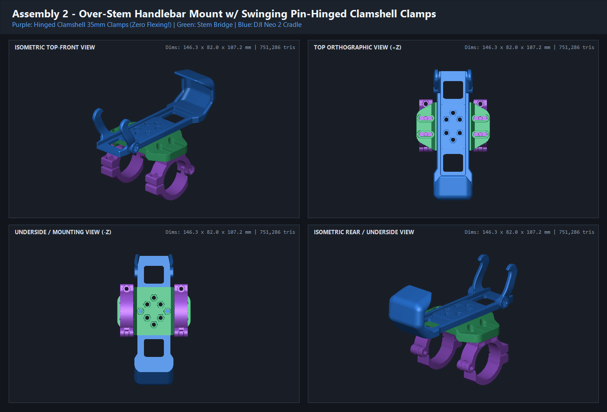
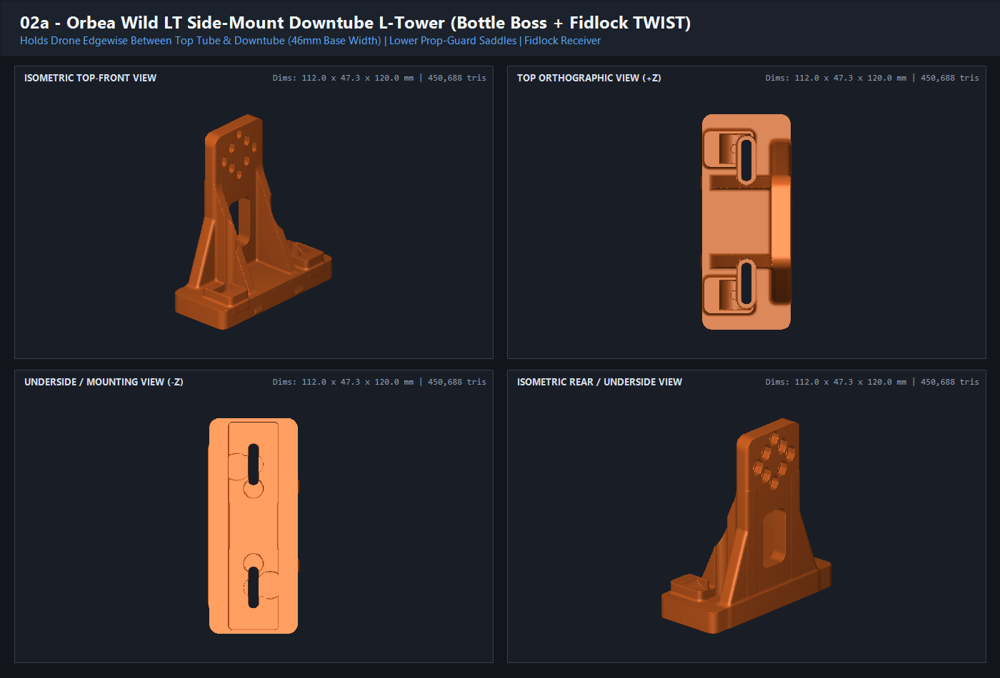
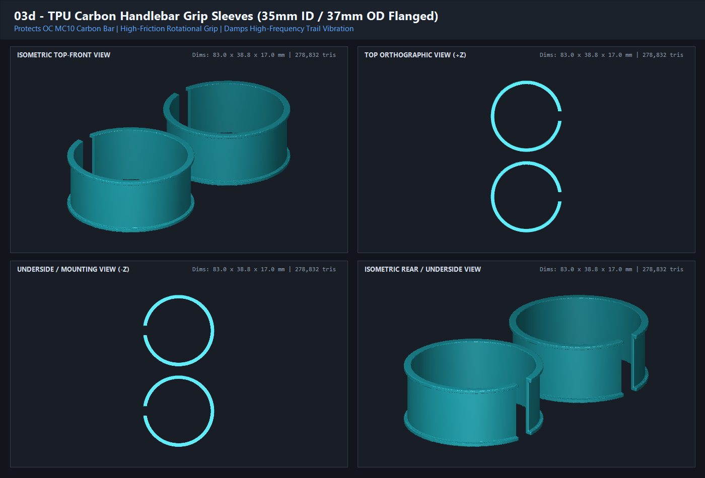

# DJI Neo 2 (w/ Transceiver) Bike Mount System — 2027 Orbea Wild LT M-Team (Size Large)

Complete parametric 3D-printable mount system engineered to carry a **DJI Neo 2 with Digital Transceiver** (`167 × 171 × 54 mm`) on a **2027 Orbea Wild LT M-Team (Size Large)** (`OC Mountain Control MC10 Carbon Ø35.0 mm Handlebar`, `OC Mountain Control MC11 40 mm Alu SL Stem`, and downtube `64 mm` water bottle cage / Fidlock TWIST boss area).

All threaded connections use **captive M4 DIN 934 hex nut pockets (`7.18 mm` across flats)** and side-entry nut traps — **zero heat-set/melt inserts required**.

---

## Key Engineering Highlights

1. **Side-Mount (Edgewise / Knee-Clearance) Downtube L-Tower (`02a` & `02c`)**:
   - Holds the DJI Neo 2 **on its side (standing vertically in the plane between the top tube and downtube)** rather than flat across the downtube.
   - Reduces total width between the rider's knees from `171 mm` down to **`55.4 mm`** (narrower than a standard `74 mm` water bottle and narrower than the Orbea Wild LT downtube itself).
   - Dual **Lower Prop-Guard Saddles** with snap-in **TPU U-channel cushions (`02b`)** support the lower edges of the propeller guards while the fuselage locks into the sideways cradle on the gusseted 90° vertical tower.
   - **Triple-mode downtube attachment:**
     1. Standard `64 mm` M5 bottle cage slots (`±8 mm` fore/aft adjustment, 100% open to a hex wrench from directly above).
     2. Integrated underside **Fidlock TWIST female keyhole receiver** (`25.8 mm` Bike Base saddle + clockwise twist-release undercut sockets at `X = ±32 mm` + `Ø10.25 × 3.2 mm` neodymium magnet pockets at `X = ±19.5 mm` + mechanical side snap-ribs).
     3. Compatible with an official Fidlock TWIST spare connector.

2. **Swinging M4 Pin-Hinged & Hook-Hinged Clamshell Handlebar Clamps (`03b`, `03c`, `03f`)**:
   - **Zero plastic flexing required to clear the Ø35.0 mm handlebar.** Instead of stretching a 1-piece plastic ring over a `35 mm` bar (which would yield or snap in `ASA`/`PETG`/`PLA`), each clamp prints as two separate rigid halves (`Upper Saddle` + `Lower Swinging Jaw`) joined at the front by a **3-knuckle barrel hinge pinned with an M4 bolt + captive M4 nut (`03b`/`03f`)** or an **interlocking front hook knuckle (`03c`)**.
   - The lower jaw **swings open 180°** around the `Ø35.0 mm` OC MC10 Carbon bar + `03d` flanged TPU liner with **zero bending strain**, and locks closed at the rear with a single `M4 × 20 mm` pinch bolt + captive M4 hex nut.

3. **TPU Gimbal, Lens, Sensor & Vibration Protection Suite (`04a`, `04b`, `04c`)**:
   - **`04a` TPU Shear/Bellows Vibration Isolator + 6× Flanged M4 Bolt Grommets:** Sandwiches between the Cradle (`01`) and either the Downtube L-Tower (`02a`) or Stem Bridge (`03a`), eliminating rigid plastic-to-plastic and metal-to-plastic shock transmission.
   - **`04b` Snap-In TPU Gimbal Lock Cushion & Downward Sensor Shield:** Snaps into the cradle's front camera/sensor window, sealing the downward optical/IR sensors against mud and gently hugging the outer barrel of the 2-axis gimbal (with a deep `Ø14.4 mm` non-contact lens dome so nothing touches the glass lens) to prevent unpowered gimbal end-stop hammering on rough trails.
   - **`04c` Snap-In TPU Heatsink Mud-Guard Louver:** Snaps into the rear heatsink window with 33° angled louvers that deflect front-tire pebble/mud spray while allowing airflow.

---

## 3D CAD Renders & Multi-View Inspection Sheets

### Full Cradle w/ TPU Gimbal Lock, Sensor Shield, Heatsink Louver & Vibration Isolator

### TPU Vibration Isolator + Gimbal Lock Cushion + Sensor/Heatsink Shields (`04a`, `04b`, `04c`)

### Assembly 1 — Side-Mount Downtube L-Tower (Edgewise Between Top Tube & Downtube)

### Assembly 2 — Over-Stem Handlebar Mount w/ Swinging Pin-Hinged Clamshell Clamps

### Individual Component Views

---

## Repository Structure & Files

### Ready-to-Slice Bambu Studio Build Plates (`3mf/`)
- [`3mf/Plate1_Structural_Mounts_ASA_PETG_Nylon.3mf`](3mf/Plate1_Structural_Mounts_ASA_PETG_Nylon.3mf) — Universal Cradle (`01`), Side-Mount Downtube L-Tower (`02a`), Over-Stem Bridge Plate (`03a`), and Swinging Pin-Hinged Handlebar Clamshell Clamps (`03b`).
- [`3mf/Plate2_Flexible_Dampers_TPU.3mf`](3mf/Plate2_Flexible_Dampers_TPU.3mf) — All 5 TPU Parts on One Plate: Ø35 mm Carbon Bar Grip Sleeves (`03d`), Side-Mount Prop-Guard Saddle Cushions (`02b`), Vibration Isolator Puck + 6× M4 Grommets (`04a`), Gimbal Lock Cushion & Sensor Shield (`04b`), and Heatsink Mud Louver (`04c`).
- [`3mf/Plate3_Integrated_OnePiece_Variants.3mf`](3mf/Plate3_Integrated_OnePiece_Variants.3mf) — Optional monolithic 1-piece Side-Mount Downtube L-Tower+Cradle (`02c`) and StemBridge+Cradle (`03e`).

### Individual Component Meshes (`stl/`)
| File | Dimensions (mm) | Purpose & Key Features |
| :--- | :--- | :--- |
| [`stl/01_DJI_Neo2_Universal_Cradle.stl`](stl/01_DJI_Neo2_Universal_Cradle.stl) | `146.3 × 43.9 × 44.7` | Modified from reference `DJI Neo 2 Holder 2 secure`: flat `Z = 0` bottom, reinforced central block (`1.2 mm` clear below drone belly) with **symmetric `15 × 15 mm` 4-bolt M4 square + `30 mm` 2-bolt centerline** and captive M4 hex nut pockets. |
| [`stl/02a_Orbea_Wild_Downtube_SideMount_LTower.stl`](stl/02a_Orbea_Wild_Downtube_SideMount_LTower.stl) | `112.0 × 47.4 × 120.0` | **Side-Mount 90° L-Tower Downtube Base:** Holds the drone edgewise inside the front triangle (`47.4 mm` base width). Includes `64 mm` M5 bottle slots, underside **Fidlock TWIST keyhole receiver + magnet pockets**, dual **Lower Prop-Guard Saddles**, and a gusseted 90° vertical tower. |
| [`stl/02b_Downtube_TPU_Damping_Pads.stl`](stl/02b_Downtube_TPU_Damping_Pads.stl) | `38.8 × 16.0 × 9.5` | Pair of U-grooved **TPU** saddle cushions that snap into the two lower prop-guard rests on `02a`. |
| [`stl/02c_Integrated_Downtube_SideMount_Cradle.stl`](stl/02c_Integrated_Downtube_SideMount_Cradle.stl) | `146.3 × 55.4 × 122.0` | Monolithic 1-piece fusion of `02a` and sideways `01`. |
| [`stl/02d_Orbea_Wild_Downtube_Flat_Fidlock_Mount.stl`](stl/02d_Orbea_Wild_Downtube_Flat_Fidlock_Mount.stl) | `112.0 × 110.0 × 14.0` | Optional flat-orientation downtube mount. |
| [`stl/03a_Orbea_MC11_Stem_Bridge_Plate.stl`](stl/03a_Orbea_MC11_Stem_Bridge_Plate.stl) | `54.0 × 82.0 × 14.0` | Arched bridge (`46 mm` clear center span × `6 mm` arch rise) over the **OC MC11 40 mm stem**, with `50–72 mm` slotted C-clip tracks. |
| [`stl/03b_Handlebar_35mm_Hinged_Clamshell_Clamps_For_TPU.stl`](stl/03b_Handlebar_35mm_Hinged_Clamshell_Clamps_For_TPU.stl) | `135.1 × 61.0 × 15.0` | **Recommended:** Pair of `15 mm` wide **Swinging M4 Pin-Hinged Clamshell Clamps** (`Ø37.0 mm` bore for use with TPU sleeves `03d`). Swings open 180° on a front M4 hinge pin with **zero plastic flexing**, and clamps at the rear with one M4 bolt + captive M4 nut. |
| [`stl/03c_Handlebar_35mm_HookHinge_Clamps_For_TPU.stl`](stl/03c_Handlebar_35mm_HookHinge_Clamps_For_TPU.stl) | `125.7 × 56.5 × 15.0` | **Single-Bolt Hook-In Clamshell Clamps:** Front hook knuckle + 1 rear M4 pinch bolt (`zero flexing`). |
| [`stl/03d_Handlebar_35mm_TPU_Grip_Sleeves_Pair.stl`](stl/03d_Handlebar_35mm_TPU_Grip_Sleeves_Pair.stl) | `83.0 × 38.8 × 17.0` | Flanged split **TPU** sleeves (`Ø35.0 mm` ID / `Ø37.0 mm` OD) for the **OC MC10 Carbon** bar. |
| [`stl/03e_Integrated_Stem_Bridge_Cradle.stl`](stl/03e_Integrated_Stem_Bridge_Cradle.stl) | `146.3 × 82.0 × 58.7` | Monolithic 1-piece fusion of `01` and `03a`. |
| [`stl/03f_Handlebar_35mm_Hinged_Clamshell_Direct_35mm.stl`](stl/03f_Handlebar_35mm_Hinged_Clamshell_Direct_35mm.stl) | `133.1 × 59.0 × 15.0` | Swinging M4 Pin-Hinged Clamshell Clamps bored to exact `Ø35.0 mm` direct bore. |
| [`stl/04a_TPU_Vibration_Isolator_Puck_And_Grommets.stl`](stl/04a_TPU_Vibration_Isolator_Puck_And_Grommets.stl) | `49.0 × 38.5 × 7.5` | **TPU Elastomer Isolator:** `7.5 mm` thick cellular/bellows shear pad + **6× flanged M4 bolt-head isolator grommets**. |
| [`stl/04b_TPU_Gimbal_Lock_And_Sensor_Shield.stl`](stl/04b_TPU_Gimbal_Lock_And_Sensor_Shield.stl) | `31.0 × 25.6 × 12.5` | **TPU Gimbal & Sensor Armor:** Snaps into the `20.0 × 22.6 mm` front window of `01`. Seals the downward optical/IR sensors and cradles the outer barrel of the 2-axis gimbal with a `Ø14.4 mm` non-contact recessed lens dome. |
| [`stl/04c_TPU_Heatsink_Mud_Louver.stl`](stl/04c_TPU_Heatsink_Mud_Louver.stl) | `23.0 × 25.6 × 4.6` | **TPU Heatsink Mud Shield:** Snaps into the `19.5 × 22.6 mm` rear heatsink window with 33° angled louvers. |

### Parametric C# CAD Source Code (`src/`)
- [`src/MountGeneratorCore.cs`](src/MountGeneratorCore.cs) — 3D Signed Distance Field (SDF) primitives and Dual-Projected Surface Nets manifold mesh extractor.
- [`src/PartDesigns.cs`](src/PartDesigns.cs) — Parametric engineering definitions for all mounts, hinged clamshells, Fidlock receivers, and TPU dampers.
- [`src/ExporterAndRenderer.cs`](src/ExporterAndRenderer.cs) — Binary STL exporter, Bambu Studio `.3mf` packager, and multi-view Z-buffered software renderer.

---

## Recommended Filament & Bambu Lab P2S (`0.4mm HF TC Nozzle`) Print Settings

| Component Group | Best Filament Choice | Runner-Up | Slicer Profile |
| :--- | :--- | :--- | :--- |
| **Side-Mount L-Tower (`02a`), Stem Bridge (`03a`), & Hinged Clamshells (`03b`/`03c`)** | **ASA** or **Easy Nylon** | **PETG** | `0.20 mm` layer, `5–6 walls`, `5 top/bottom`, `35% Gyroid infill`. Normal (Snug) supports on build plate only for `02a`/`03a` arch ceilings. |
| **Universal Cradle (`01`)** | **PETG** or **Easy Nylon** | **ASA** | `0.20 mm` layer, `6 walls`, `30% Gyroid infill`, **No supports**. |
| **TPU Sleeves (`03d`), Saddle Pads (`02b`), Isolator (`04a`), Gimbal Lock (`04b`), & Louver (`04c`)** | **TPU (95A)** | — | `0.20 mm` layer, **`2–3 walls`**, **`15–20% Gyroid infill`**, **No supports** (keeps the gimbal side-cheeks and isolator bellows plush and compliant). |

---

## Hardware Bill of Materials (Captive M4 Hex Nuts — No Melt Inserts)

- **Mount 1 (Side-Mount Downtube L-Tower):**
  - `4× M4 × 20 mm` bolts (or `M4 × 14 mm` if mounting without the `7.5 mm` `04a` TPU isolator puck) + `4× M4 DIN 934 hex nuts`.
  - `2× Standard M5 × 14–16 mm` bottle cage bolts (or `2× Ø10 × 3 mm` neodymium magnets for Fidlock TWIST Bike Base attachment).
- **Mount 2 (Over-Stem Handlebar Clamshell Mount):**
  - `2× M4 × 18–20 mm` bolts + `2× M4 hex nuts` for the front 3-knuckle clamshell hinge pins (`03b`).
  - `2× M4 × 20 mm` bolts + `2× M4 hex nuts` for the rear clamshell pinch bolts (`03b`).
  - `4× M4 × 14 mm` bolts + `4× M4 hex nuts` to bolt the Over-Stem Bridge Plate (`03a`) to the two handlebar clamps.
  - `4× M4 × 20 mm` bolts (with `04a` TPU isolator) + `4× M4 hex nuts` to bolt the Universal Cradle (`01`) to the Over-Stem Bridge Plate.
