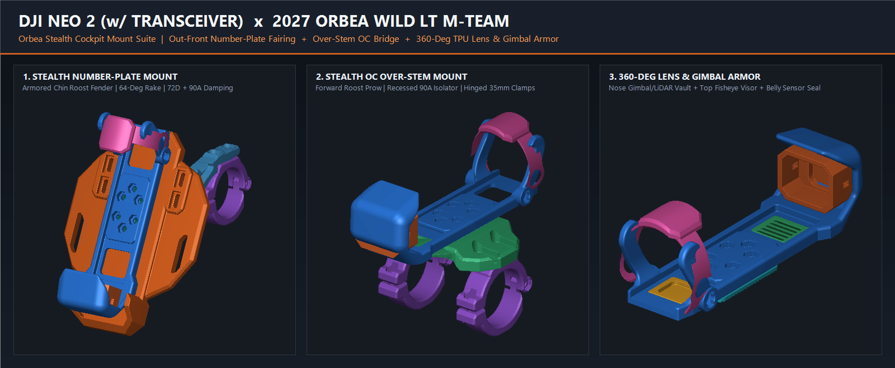
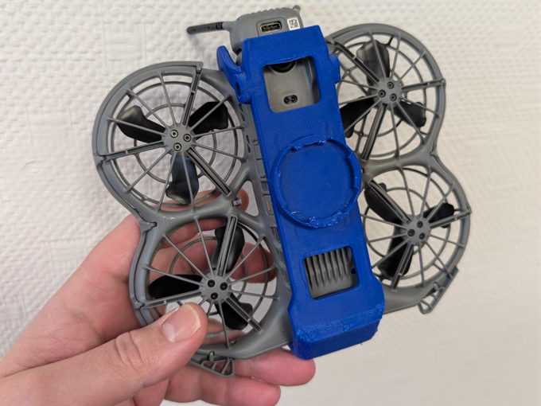
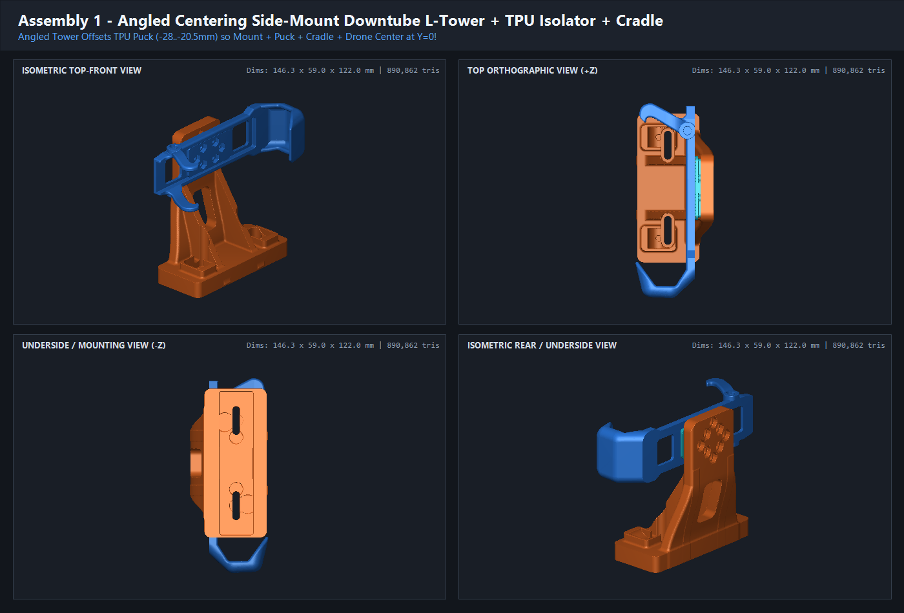
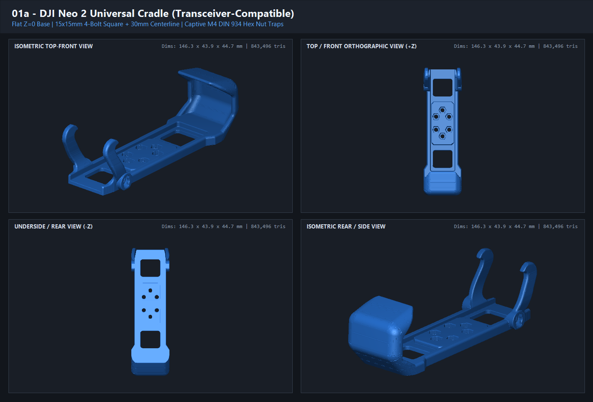
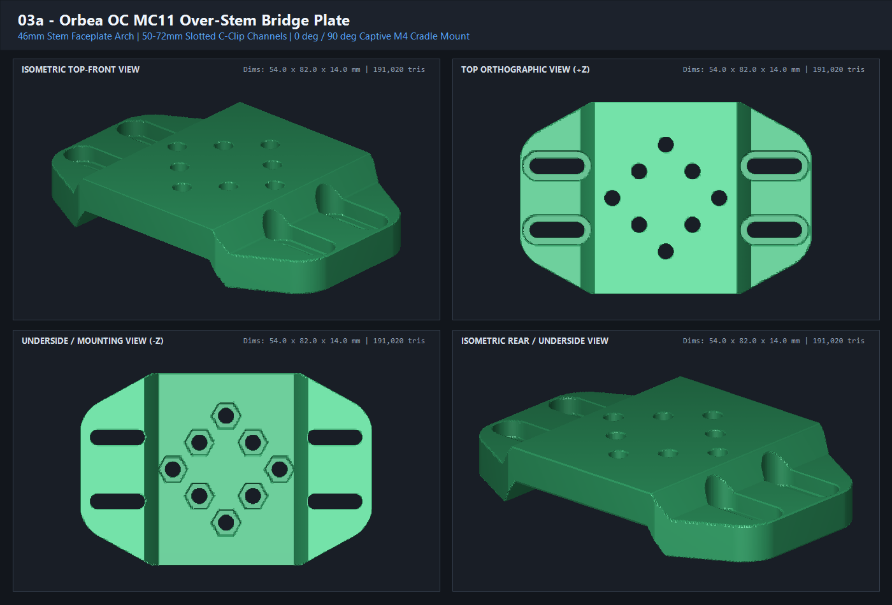
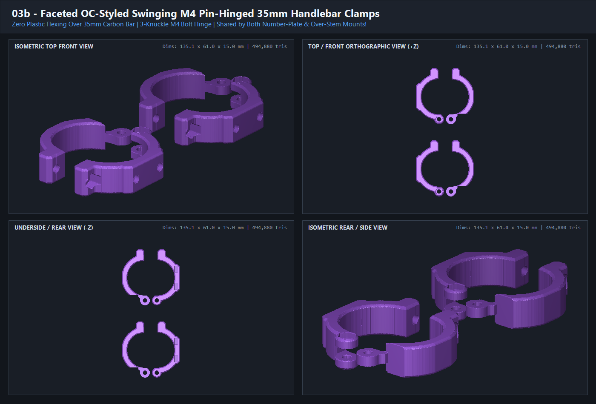
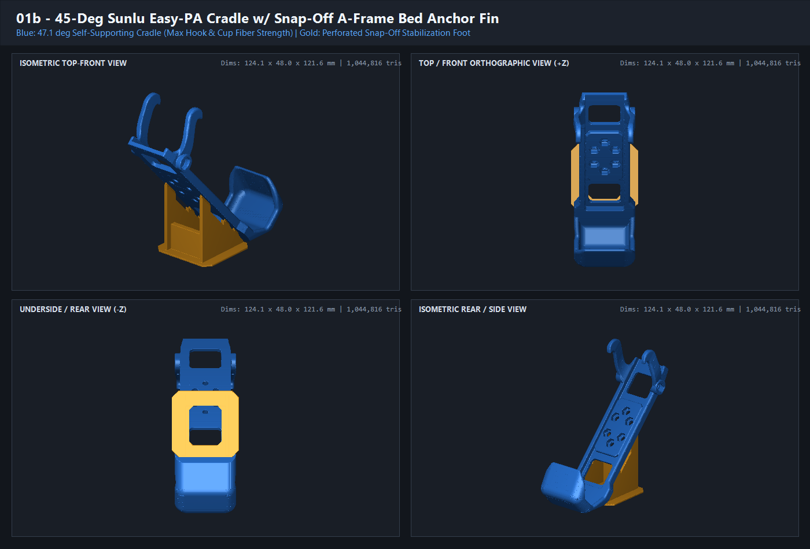

<div align="center">

# DJI Neo 2 (w/ Transceiver) × 2027 Orbea Wild LT M-Team
### Custom 3D-Printable Enduro e-MTB Mount System & TPU Gimbal Armor Suite


-ff6600?style=for-the-badge)
-00ae42?style=for-the-badge)

-2ecc71?style=for-the-badge)

<br/>



<p align="center">
  <b>Two dedicated trail-ready mounting systems</b> to carry a <b>DJI Neo 2 with Digital Transceiver</b> (<code>167 × 171 × 54 mm</code>) on a <b>2027 Orbea Wild LT M-Team (Size Large)</b>:<br/>
  <b>(1) Side-Mount Downtube L-Tower</b> (<code>64 mm</code> Bottle Cage Bosses + Integrated <b>Fidlock TWIST</b> Receiver) &nbsp;|&nbsp;
  <b>(2) Over-Stem Swinging Clamshell Mount</b> (<code>OC MC11 40mm Stem</code> + <code>OC MC10 Ø35.0mm Carbon Bar</code>) &nbsp;|&nbsp;
  <b>(3) Full TPU Gimbal, Sensor & Vibration Armor</b>
</p>

[Quick Download (.3MF Plates)](#-one-click-bambu-studio-build-plates-3mf) •
[Visual Gallery](#-3d-assembly--component-gallery) •
[Engineering Architecture](#-engineering-highlights--problem-solving) •
[STL Catalog](#-individual-stl-part-catalog) •
[Bambu P2S Print Settings](#-bambu-lab-p2s-04mm-hf-tc-slicer-settings) •
[Hardware BOM & Assembly](#-hardware-bill-of-materials--assembly-guide)

</div>

---

## ⚡ One-Click Bambu Studio Build Plates (`.3mf`)

All parts are pre-oriented on `256 × 256 mm` build plates for the **Bambu Lab P2S** to maximize perimeter strength along load paths and minimize or eliminate supports:

| Build Plate | Filament | Contents | Download |
| :--- | :--- | :--- | :---: |
| **Plate 1 — Structural Mounts** | `ASA` / `Easy Nylon` / `PETG` | Universal Cradle (`01`) + Side-Mount Downtube L-Tower (`02a`) + Over-Stem Bridge Plate (`03a`) + Swinging Pin-Hinged 35mm Handlebar Clamshells (`03b`) | [**Download Plate 1 (.3mf)**](3mf/Plate1_Structural_Mounts_ASA_PETG_Nylon.3mf) |
| **Plate 2 — TPU Protection & Isolator Suite** | `TPU 95A` | Ø35mm Carbon Bar Grip Sleeves (`03d`) + Prop-Guard Saddle Cushions (`02b`) + Shear Vibration Isolator Puck & 6× M4 Grommets (`04a`) + Gimbal Lock & Sensor Shield (`04b`) + Heatsink Mud Louver (`04c`) | [**Download Plate 2 (.3mf)**](3mf/Plate2_Flexible_Dampers_TPU.3mf) |
| **Plate 3 — Monolithic 1-Piece Variants** | `ASA` / `Easy Nylon` / `PETG` | Optional 1-Piece Fused Side-Mount Downtube+Cradle (`02c`) + 1-Piece Fused StemBridge+Cradle (`03e`) | [**Download Plate 3 (.3mf)**](3mf/Plate3_Integrated_OnePiece_Variants.3mf) |
| **Plate 4 — 45° Sunlu Easy-PA Cradle w/ Snap-Off Anchor Fin** | `Sunlu Easy-PA` (Nylon) | Pre-angled `47.1°` Universal Cradle (`01b`) with integrated perforated snap-off A-frame stabilization foot for maximum hook & cup fiber strength with zero slicer supports | [**Download Plate 4 (.3mf)**](3mf/Plate4_Cradle_45Deg_Sunlu_EasyPA.3mf) |
| **Plate 5 — Rigid PETG Fastener Inserts for 72D TPU Mounts** | `PETG` / `ASA` / `Easy-PA` | Unified 6-Nut Cradle Carrier Plate (snaps into `01c`) + 2× M5 Bottle-Slot Load-Spreader Plates (for `02a`) + 8× Press-In Flanged Hex-Collar M4 Bolt Bushings (for `01` & `02a`) | [**Download Plate 5 (.3mf)**](3mf/Plate5_PETG_Inserts_For_72D_TPU.3mf) |

---

## 🛠️ Engineering Highlights & Problem-Solving

<table>
  <tr>
    <td width="42%" align="center">
      
      <br/>
      <sub><b>Reference Holster Fitment:</b> DJI Neo 2 with Digital Transceiver clipped into the base cradle shell.</sub>
    </td>
    <td width="58%">
      <h3>Why This System Was Engineered</h3>
      <ul>
        <li><b>Zero Knee Interference on the Downtube (<code>55.4 mm</code> Width):</b> Mounting a <code>171 mm</code> wide DJI Neo 2 flat on the downtube sticks out <code>85.5 mm</code> per side into the rider's pedaling envelope. Our <b>Side-Mount 90° L-Tower (<code>02a</code>)</b> stands the drone <b>on its side inside the front triangle</b> between the top tube and downtube—narrower than a standard <code>74 mm</code> water bottle and narrower than the Orbea Wild LT downtube itself.</li>
        <li><b>Zero Plastic Flexing Over the Ø35.0 mm Carbon Bar:</b> Pulling a rigid 1-piece plastic C-ring open by <code>35 mm</code> to clear a mountain bike handlebar causes brittle fracture or permanent yield. Our <b>Swinging M4 Pin-Hinged Clamshell Clamps (<code>03b</code>)</b> use a 3-knuckle barrel hinge pinned by an M4 bolt so the lower jaw swings open <code>180°</code> with <b>0% bending strain</b>.</li>
        <li><b>2-Axis Gimbal & Optical Sensor Protection:</b> Unpowered 2-axis gimbals hammer against their end-stops under trail chatter. Our <b>TPU Vibration Isolator Puck (<code>04a</code>)</b> decouples high-frequency shock, while the snap-in <b>TPU Gimbal Lock Cushion & Sensor Shield (<code>04b</code>)</b> gently immobilizes the outer gimbal barrel (with a <code>Ø14.4 mm</code> non-contact lens cavity) and seals the downward sensors from mud.</li>
        <li><b>Captive M4 Hex Nuts Throughout:</b> Every threaded joint uses precision <code>7.18 mm</code> across-flats DIN 934 hex nut traps—<b>no heat-set/melt inserts or soldering iron required</b>.</li>
      </ul>
    </td>
  </tr>
</table>

---

## 📸 3D Assembly & Component Gallery

### Complete Multi-Part Assemblies

<table>
  <tr>
    <td width="50%" align="center">
      
      <br/>
      <b>Assembly 1: Side-Mount Downtube L-Tower (<code>02a</code> + <code>01</code>)</b><br/>
      <sub>Holds the drone edgewise inside the front triangle (<code>55.4 mm</code> total width). Features dual lower prop-guard saddles, open <code>64 mm</code> M5 bottle slots, and an underside Fidlock TWIST receiver.</sub>
    </td>
    <td width="50%" align="center">
      
      <br/>
      <b>Assembly 2: Over-Stem Handlebar Clamshell Mount (<code>03a</code> + <code>03b</code> + <code>01</code>)</b><br/>
      <sub>Straddles the <code>40 mm</code> OC MC11 stem faceplate with slotted <code>50–72 mm</code> lateral adjustment and swinging M4 pin-hinged <code>Ø35.0 mm</code> bar clamps.</sub>
    </td>
  </tr>
  <tr>
    <td width="50%" align="center">
      
      <br/>
      <b>Assembly 3: Cradle Equipped w/ Full TPU Gimbal & Vibration Armor</b><br/>
      <sub><b>Blue:</b> Universal Cradle (<code>01</code>) &nbsp;|&nbsp; <b>Cyan:</b> TPU Shear Isolator + Grommets (<code>04a</code>) &nbsp;|&nbsp; <b>Gold:</b> Snap-In Gimbal Lock & Sensor Shield (<code>04b</code>) &nbsp;|&nbsp; <b>Green:</b> Heatsink Mud Louver (<code>04c</code>).</sub>
    </td>
    <td width="50%" align="center">
      
      <br/>
      <b>TPU Gimbal, Sensor & Vibration Protection Suite (<code>04a</code>, <code>04b</code>, <code>04c</code>)</b><br/>
      <sub>Printed in <code>TPU 95A</code> with 2–3 walls and 15–20% Gyroid infill for plush elastomer compliance and trail shock attenuation.</sub>
    </td>
  </tr>
</table>

### Individual Component Orthographic & Isometric Inspection Sheets

<table>
  <tr>
    <td width="50%" align="center">
      
      <br/>
      <b><code>01</code> — DJI Neo 2 Universal Cradle</b><br/>
      <sub>100% flat <code>Z = 0</code> bottom face; symmetric <code>15 × 15 mm</code> 4-bolt M4 square + <code>30 mm</code> centerline pattern with captive M4 hex nut pockets recessed <code>1.2 mm</code> below the drone belly plane.</sub>
    </td>
    <td width="50%" align="center">
      
      <br/>
      <b><code>02a</code> — Orbea Wild LT Side-Mount Downtube L-Tower</b><br/>
      <sub><code>47.4 mm</code> base width, twin gusset ribs, lower prop-guard saddles, <code>64 mm</code> M5 slots, and underside Fidlock TWIST keyhole sockets + <code>Ø10 × 3 mm</code> magnet pockets.</sub>
    </td>
  </tr>
  <tr>
    <td width="50%" align="center">
      
      <br/>
      <b><code>03a</code> — Orbea OC MC11 Over-Stem Bridge Plate</b><br/>
      <sub><code>46 mm</code> wide × <code>6 mm</code> high underside arch clears the OC MC11 stem faceplate; supports <code>0°</code> (fore-aft) or <code>90°</code> (transverse) cradle mounting.</sub>
    </td>
    <td width="50%" align="center">
      
      <br/>
      <b><code>03b</code> — Swinging M4 Pin-Hinged 35mm Handlebar Clamps</b><br/>
      <sub>Upper Saddle and Lower Swinging Jaw print separated on the bed, join at the front 3-knuckle hinge via an M4 bolt, and clamp at the rear with one M4 pinch bolt.</sub>
    </td>
  </tr>
  <tr>
    <td width="50%" align="center">
      
      <br/>
      <b><code>03d</code> — Flanged TPU Grip Sleeves for OC MC10 Ø35.0 mm Carbon Handlebar</b><br/>
      <sub><code>35.0 mm</code> ID / <code>37.0 mm</code> OD split sleeves with <code>1.0 mm</code> side retaining lips that protect the carbon finish and prevent rotational slip at low bolt torque.</sub>
    </td>
    <td width="50%" align="center">
      
      <br/>
      <b><code>01b</code> — 45° Sunlu Easy-PA Cradle w/ Snap-Off A-Frame Anchor Fin</b><br/>
      <sub>Rotated to its native <code>47.1°</code> self-supporting angle so continuous Nylon fibers run through the latch hooks and nose cup. Perforated <code>0.64 mm</code> tabs snap off cleanly after printing.</sub>
    </td>
  </tr>
  <tr>
    <td colspan="2" align="center">
      
      <br/>
      <b><code>05</code> — Rigid PETG Fastener Reinforcement Insert Kit for 72D TPU Mounts</b><br/>
      <sub><b>Center:</b> Unified 6-Nut Carrier Plate (snaps into <code>01c</code> so M4 nuts can never spin or pull through <code>72D TPU</code>) &nbsp;|&nbsp; <b>Top:</b> 2× M5 Bottle-Boss Slot Load-Spreader Plates (drop into <code>02a</code>) &nbsp;|&nbsp; <b>Bottom:</b> 8× Flanged Hex-Collar M4 Bushings (press into standard <code>7.18 mm</code> hex pockets on <code>01</code> or <code>02a</code>).</sub>
    </td>
  </tr>
</table>

---

## 🧩 System Architecture & Fastener Flow

```mermaid
flowchart TD
    subgraph StemMount["Mount 2: Over-Stem Cockpit Mount (Orbea OC MC10 Carbon Bar + MC11 40mm Stem)"]
        Bar["OC MC10 Carbon Handlebar (Ø35.0 mm)"] --> TPUSleeve["03d: TPU Flanged Grip Sleeves (Ø35mm ID / Ø37mm OD)"]
        TPUSleeve --> Clamshell["03b: Swinging M4 Pin-Hinged Clamshell Clamps (Front M4 Hinge Pin + Rear M4 Pinch Bolt)"]
        Clamshell --> Bridge["03a: Over-Stem Bridge Plate (4x M4x14 Bolts into Upper Saddle Captive M4 Nuts)"]
        Bridge --> IsolatorS["04a: TPU Vibration Isolator Puck + 6x Flanged M4 Grommets"]
        IsolatorS --> CradleS["01: Universal Cradle + 04b TPU Gimbal Lock + 04c Mud Louver"]
    end

    subgraph DowntubeMount["Mount 1: Side-Mount (Edgewise) Downtube L-Tower (55.4mm Total Width)"]
        Frame["Orbea Wild LT Downtube (64mm M5 Bosses OR Fidlock TWIST Bike Base)"] --> DTBase["02a: Side-Mount 90° L-Tower Base (47.4mm Wide)"]
        DTBase --> TPUSaddles["02b: 2x Snap-In TPU U-Groove Lower Prop-Guard Saddle Cushions"]
        DTBase --> IsolatorDT["04a: TPU Vibration Isolator Puck + 6x Flanged M4 Grommets"]
        IsolatorDT --> CradleDT["01: Universal Cradle + 04b TPU Gimbal Lock + 04c Mud Louver"]
        TPUSaddles -. "Cushions lower prop-guard edge" .-> CradleDT
    end
```



---

## 📦 Individual `.STL` Part Catalog

| Part ID | STL File | Dimensions (mm) | Recommended Material | Description |
| :---: | :--- | :---: | :---: | :--- |
| **`01`** | [`01_DJI_Neo2_Universal_Cradle.stl`](stl/01_DJI_Neo2_Universal_Cradle.stl) | `146.3 × 43.9 × 44.7` | `PETG` / `Easy Nylon` | Universal DJI Neo 2 + Transceiver cradle with flat `Z = 0` bottom and `15 × 15 mm` square + `30 mm` centerline captive M4 hex nut pockets. |
| **`01b`** | [`01b_DJI_Neo2_Universal_Cradle_45Deg_With_AnchorFin.stl`](stl/01b_DJI_Neo2_Universal_Cradle_45Deg_With_AnchorFin.stl) | `124.4 × 48.0 × 121.6` | `Sunlu Easy-PA` | **45° Pre-Angled Nylon Cradle:** Tilted at `47.1°` on the closed-cup heel pad with a wide-base perforated snap-off A-frame stabilization fin (`zero slicer supports needed`; maximizes hook & cup flexural strength). |
| **`01c`** | [`01c_DJI_Neo2_72D_TPU_Cradle_For_PETG_Insert.stl`](stl/01c_DJI_Neo2_72D_TPU_Cradle_For_PETG_Insert.stl) | `146.3 × 43.9 × 44.7` | `Elegoo 72D TPU` | **72D TPU Cradle w/ Snap-In Carrier Pocket:** Features a `43.0 × 21.6 × 3.6 mm` recessed pocket with a `0.35 mm` retention lip that captures the rigid 6-nut PETG Carrier Plate (`05`). |
| **`02a`** | [`02a_Orbea_Wild_Downtube_SideMount_LTower.stl`](stl/02a_Orbea_Wild_Downtube_SideMount_LTower.stl) | `94.6 × 50.9 × 108.5` | `Elegoo 72D TPU` / `Easy-PA` | **Primary Sleek Twin-Spar Downtube L-Tower (`41.8 cm³` / `~50 g`):** `65.5%` lighter skeletal A-frame with 100% flat `Z = 0` base (`zero underside supports`), parabolic open-truss gussets, `7.0 mm` lower profile (`Z_center = 93 mm`), and contoured stadium head (`Y = -28.0 mm` puck pocket) that centers `[Tower + Puck + Cradle + Drone]` at `Y = 0`! |
| **`02b`** | [`02b_Downtube_TPU_Damping_Pads.stl`](stl/02b_Downtube_TPU_Damping_Pads.stl) | `38.8 × 16.0 × 9.5` | `TPU 90A / 95A` | Pair of U-grooved TPU cushions that snap into the lower prop-guard saddles on `02a`. |
| **`02c`** | [`02c_Integrated_Downtube_SideMount_Cradle.stl`](stl/02c_Integrated_Downtube_SideMount_Cradle.stl) | `146.3 × 54.4 × 115.0` | `PETG` / `ASA` | Optional 1-piece monolithic fusion of sleek `02a` and sideways `01`. |
| **`02d`** | [`02d_Orbea_Wild_Downtube_Flat_Fidlock_Mount.stl`](stl/02d_Orbea_Wild_Downtube_Flat_Fidlock_Mount.stl) | `112.0 × 110.0 × 14.0` | `ASA` / `PETG` | Alternate flat-orientation downtube mount with 4 prop-guard wings. |
| **`02f`** | [`02f_Orbea_Wild_Downtube_Fidlock_SideMount_LTower.stl`](stl/02f_Orbea_Wild_Downtube_Fidlock_SideMount_LTower.stl) | `112.0 × 58.7 × 121.0` | `ASA` / `Easy Nylon` | **Archived Fidlock-Compatible L-Tower (`121.4 cm³`):** Full-base version with underside Fidlock TWIST keyhole sockets + magnet pockets. |
| **`03a`** | [`03a_Orbea_MC11_Stem_Bridge_Plate.stl`](stl/03a_Orbea_MC11_Stem_Bridge_Plate.stl) | `54.0 × 82.0 × 14.0` | `ASA` / `Easy Nylon` | Arched bridge over the **OC MC11 40mm stem** with `50–72 mm` slotted C-clip tracks and `0°`/`90°` captive M4 cradle mounting. |
| **`03b`** | [`03b_Handlebar_35mm_Hinged_Clamshell_Clamps_For_TPU.stl`](stl/03b_Handlebar_35mm_Hinged_Clamshell_Clamps_For_TPU.stl) | `135.1 × 61.0 × 15.0` | `ASA` / `PETG` / `Nylon` | **Primary Bar Clamps:** Swinging M4 pin-hinged clamshells (`Ø37.0 mm` bore for use with `03d` TPU sleeves). Zero flexing during install. |
| **`03c`** | [`03c_Handlebar_35mm_HookHinge_Clamps_For_TPU.stl`](stl/03c_Handlebar_35mm_HookHinge_Clamps_For_TPU.stl) | `125.7 × 56.5 × 15.0` | `ASA` / `PETG` / `Nylon` | Single-bolt front hook-hinged clamshell bar clamps (`Ø37.0 mm` bore for `03d` TPU sleeves). |
| **`03d`** | [`03d_Handlebar_35mm_TPU_Grip_Sleeves_Pair.stl`](stl/03d_Handlebar_35mm_TPU_Grip_Sleeves_Pair.stl) | `83.0 × 38.8 × 17.0` | `TPU 95A` | Flanged split TPU sleeves (`Ø35.0 mm` ID / `Ø37.0 mm` OD) to protect the **OC MC10 Carbon** bar. |
| **`03e`** | [`03e_Integrated_Stem_Bridge_Cradle.stl`](stl/03e_Integrated_Stem_Bridge_Cradle.stl) | `146.3 × 82.0 × 58.7` | `PETG` / `ASA` | Optional 1-piece monolithic fusion of `03a` and `01`. |
| **`03f`** | [`03f_Handlebar_35mm_Hinged_Clamshell_Direct_35mm.stl`](stl/03f_Handlebar_35mm_Hinged_Clamshell_Direct_35mm.stl) | `133.1 × 59.0 × 15.0` | `ASA` / `PETG` / `Nylon` | Swinging M4 pin-hinged clamshell clamps bored to exact `Ø35.0 mm` for bare-bar mounting without TPU sleeves. |
| **`04a`** | [`04a_TPU_Vibration_Isolator_Puck_And_Grommets.stl`](stl/04a_TPU_Vibration_Isolator_Puck_And_Grommets.stl) | `49.0 × 38.5 × 7.5` | `TPU 95A` | `7.5 mm` thick cellular/bellows shear isolator pad + **6× flanged M4 bolt-head isolator grommets**. |
| **`04b`** | [`04b_TPU_Gimbal_Lock_And_Sensor_Shield.stl`](stl/04b_TPU_Gimbal_Lock_And_Sensor_Shield.stl) | `31.0 × 25.6 × 12.5` | `TPU 95A` | Snap-in TPU gimbal stabilizer cushion (`Ø14.4 mm` non-contact lens dome) + downward optical/IR sensor mud shield. |
| **`04c`** | [`04c_TPU_Heatsink_Mud_Louver.stl`](stl/04c_TPU_Heatsink_Mud_Louver.stl) | `23.0 × 25.6 × 4.6` | `TPU 90A / 95A` | Snap-in 33° louvered mud/pebble shield for the rear heatsink cutout. |
| **`05`** | [`05_PETG_Reinforcement_Inserts_For_72D_TPU.stl`](stl/05_PETG_Reinforcement_Inserts_For_72D_TPU.stl) | `86.6 × 47.6 × 4.6` | `PETG` / `ASA` | **Rigid Fastener Insert Kit for 72D TPU:** (1) Unified 6-Nut Cradle Carrier Plate (`42.6 × 21.2 × 3.5 mm`, snaps into `01c`); (2) 2× M5 Bottle-Slot Load-Spreader Plates (`25.6 × 9.8 × 2.4 mm`, drop into `02a`); (3) 8× Press-In Flanged Hex-Collar M4 Bushings (`7.08 mm` AF hex + `Ø9.5 mm` flange, press into standard hex pockets of `01` or `02a`). |

---

## 🖨️ Bambu Lab P2S (`0.4mm HF TC`) Slicer Settings & Graded-Durometer Strategy

> [!TIP]
> **Multi-Durometer ("Graded Stiffness") Vibration Damping:** Combining **`Sunlu Easy-PA`**, **`Elegoo 72D Hard TPU`**, **`90A Soft TPU`**, and **`Rigid PETG Fastener Inserts`** creates a true 3-stage progressive suspension tuned specifically for the light `160 g` DJI Neo 2:
> 1. **Stage 1 — Structural Clamping & Retention (`Sunlu Easy-PA` or `Elegoo 72D TPU`):** Use `Sunlu Easy-PA` on the `45°` Cradle (`01b`), Stem Bridge (`03a`), and Swinging Bar Clamps (`03b`)—or print a second cradle flat at `0°` (`01c`) in **`Elegoo 72D TPU`** (`7–8 walls, 50% Gyroid`) with the snap-in **Rigid PETG 6-Nut Carrier Plate (`05`)** for unbreakable, cold-weather-proof latch hooks.
> 2. **Stage 2 — Mid-Frequency Frame & G-Out Damping (`Elegoo 72D TPU` on Sleek `02a` L-Tower):** Printing the `41.8 cm³` twin-spar open-truss L-Tower (`02a`) in **`Elegoo 72D TPU`** (`6 walls, 45–50% Gyroid`) with the drop-in **Rigid PETG M5 Slot Plates & Flanged Hex Bushings (`05`)** lets the twin A-frame struts act as an indestructible viscoelastic leaf spring on big hits (`5–30 Hz`).
> 3. **Stage 3 — High-Frequency Micro-Chatter Isolation (`90A TPU` on `04a`, `04b`, `02b`, `03d`):** Using softer **`90A TPU`** (`2–3 walls, 15% Gyroid`) for the bellows isolator puck (`04a`), gimbal cushion (`04b`), prop-guard saddles (`02b`), and carbon bar sleeves (`03d`) lowers the isolator cutoff frequency to filter out `30–120 Hz` trail buzz before it reaches the 2-axis gimbal bearings.

| Parameter | Structural Nylon (`Sunlu Easy-PA`) | Semi-Rigid Elastomer (`Elegoo 72D TPU`) | Fastener Inserts (`PETG` / `ASA`) | Soft Dampers & Armor (`90A / 95A TPU`) |
| :--- | :--- | :--- | :--- | :--- |
| **Target Parts** | `01b` (45° Cradle), `03a` (Stem Bridge), `03b` (Clamshells) | `02a` (Sleek Twin-Spar L-Tower), `01c` (Flat 72D Cradle) | `05` (6-Nut Carrier, M5 Slot Plates, Hex Bushings) | `04a` (Isolator Puck), `04b` (Gimbal Lock), `04c` (Louver), `02b` (Saddles), `03d` (Bar Sleeves) |
| **Nozzle** | `0.4 mm` HF TC (`260–265°C`, dry 8h @ `75°C`) | `0.4 mm` HF TC (`235–245°C`) | `0.4 mm` HF TC (`245–255°C`) | `0.4 mm` HF TC (`225–235°C`) |
| **Layer Height** | `0.20 mm` | `0.20 mm` | `0.20 mm` | `0.20 mm` |
| **Wall Loops** | **`6 walls`** | **`6 to 8 walls`** | **`6 walls` (Solid)** | **`2 walls` (`04a`/`04b`) to `3 walls` (`03d`)** |
| **Top / Bottom Shells** | `5 Top / 5 Bottom` (`1.0 mm`) | `5 Top / 5 Bottom` (`1.0 mm`) | `6 Top / 6 Bottom` | `4 Top / 4 Bottom` (`0.8 mm`) |
| **Infill Pattern & Density** | **`35% Gyroid`** | **`45%–55% Gyroid`** | **`100% Rectilinear`** | **`15%–20% Gyroid`** |
| **Supports** | **None** on `01b` & `03b`; **Build-plate only** on `03a` arch | **None** (Sleek `02a` & `01c` have 100% flat `Z = 0` bases!) | **None** | **None** |

---

## 🔩 Hardware Bill of Materials & Assembly Guide

### Mount 1: Side-Mount Downtube L-Tower (`02a` + `01` + `02b` + `04a/b/c`)
- **Hardware Needed:**
  - `4× M4 × 20 mm` socket-head or button-head bolts (use `M4 × 14 mm` if omitting the `7.5 mm` `04a` TPU isolator puck)
  - `4× M4 DIN 934 hex nuts`
  - `2× Standard M5 × 14–16 mm` bottle cage bolts + M5 washers *(or `2× Ø10 × 3 mm` neodymium magnets for Fidlock TWIST Bike Base attachment)*
- **Assembly Steps:**
  1. Snap the **TPU Gimbal Lock & Sensor Shield (`04b`)** into the front camera/sensor window of the **Universal Cradle (`01`)**, and snap the **TPU Heatsink Louver (`04c`)** into the rear window.
  2. Snap the two **TPU U-Groove Saddle Cushions (`02b`)** into the lower prop-guard rests on the base of the **Side-Mount L-Tower (`02a`)**.
  3. Press 4× **M4 hex nuts** into the pointed-top hex pockets on the back of the vertical L-Tower (or into the top hex pockets inside the cradle floor), place the **TPU Vibration Isolator Puck (`04a`)** between the Cradle and the L-Tower wall, insert the **flanged TPU grommets (`04a`)** under the M4 bolt heads, and tighten the 4× `M4 × 20 mm` bolts. *(Orient the cradle with the closed cup or nose pointing up toward the head tube for best tire-spray protection).*
  4. Bolt the L-Tower base to your Orbea Wild LT downtube `64 mm` bosses using 2× M5 bolts through the open top slots—or twist-lock it directly onto your **Fidlock TWIST Bike Base**.

### Mount 2: Over-Stem Handlebar Clamshell Mount (`03a` + `03b` + `03d` + `01` + `04a/b/c`)
- **Hardware Needed:**
  - `2× M4 × 18–20 mm` bolts + `2× M4 hex nuts` *(front clamshell hinge pins)*
  - `2× M4 × 20 mm` bolts + `2× M4 hex nuts` *(rear clamshell pinch bolts)*
  - `4× M4 × 14 mm` bolts + `4× M4 hex nuts` *(Over-Stem Bridge Plate to C-clip saddles)*
  - `4× M4 × 20 mm` bolts + `4× M4 hex nuts` *(Cradle + `04a` TPU isolator to Over-Stem Bridge Plate)*
- **Assembly Steps:**
  1. Assemble each **Swinging Clamshell Clamp (`03b`)** by placing the lower jaw's center hinge tongue between the upper saddle's two front knuckles, pressing an M4 hex nut into the outer knuckle recess, and threading an `M4 × 18–20 mm` bolt through as the permanent hinge pin.
  2. Wrap the two **Flanged TPU Grip Sleeves (`03d`)** around the **Ø35.0 mm OC MC10 Carbon Handlebar** immediately to the left and right of the **OC MC11 stem faceplate**.
  3. Swing the two clamshell clamps open around the TPU sleeves, close them, and thread the rear `M4 × 20 mm` pinch bolts into the rear captive M4 hex nuts (`snug only to ~1.5–2.0 Nm`).
  4. Slide 4× M4 hex nuts into the horizontal side-entry slots at the top of the two handlebar clamps, place the **Over-Stem Bridge Plate (`03a`)** across the stem, slide the clamps flush against the left and right sides of the stem faceplate, and tighten the 4× `M4 × 14 mm` bridge bolts.
  5. Bolt the **Universal Cradle (`01`)** + **TPU Vibration Isolator (`04a`)** on top of the bridge plate in either `0°` (fore-aft) or `90°` (transverse) orientation.

---

## 💻 Rebuilding from Source

All 3D models and multi-angle orthographic/isometric renders are generated deterministically from pure C# Signed Distance Field (SDF) equations using Dual-Projected Surface Nets (zero external CAD dependencies required—runs natively in Windows PowerShell / .NET):

```powershell
$srcDir = ".\src"
$files = @(
    "$srcDir\MountGeneratorCore.cs",
    "$srcDir\PartDesigns.cs",
    "$srcDir\ExporterAndRenderer.cs",
    "$srcDir\HeroBannerGenerator.cs"
)
Add-Type -Path $files -ReferencedAssemblies System.Xml, System.IO.Compression, System.IO.Compression.FileSystem, System.Drawing
[DjiNeo2OrbeaMounts.Program]::Main(@())
[DjiNeo2OrbeaMounts.HeroBannerGenerator]::Generate()
```
